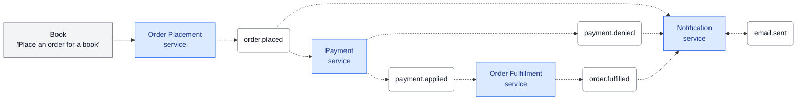

# Event-Driven Architecture: Order Processing System

An asynchronous, event-driven microservices system simulating an end-to-end e-commerce order workflow using **Python**, **RabbitMQ**, and **Docker Compose**.

---

## 📖 Architecture & Concept Overview

In an event-driven architecture, services do not directly call one another via synchronous APIs (like HTTP/REST). Instead, each service acts independently:
1. **Listens** to specific immutable facts (**Events**) delivered to its private queue.
2. **Executes** its domain logic.
3. **Emits** new events into the message broker to announce what happened.

### Message Flow Diagram



---

## 🧩 Microservices Summary

| Service | Consumes (Routing Keys) | Produces (Event Type) | Responsibilities |
|---|---|---|---|
| **Order Placement (`app`)** | *(None - Triggered on demand)* | `order.placed` | Validates book catalog, calculates order totals, generates UUID correlation IDs, and dispatches the initiating event. |
| **Payment Service** | `order.placed` | `payment.applied` *or* `payment.denied` | Verifies customer account status and wallet balances. Emits either approval or denial with failure reasons. |
| **Fulfillment Service** | `payment.applied` | `order.fulfilled` | Handles logistics packaging, generates shipment tracking codes (`TRK-...`), and schedules delivery. |
| **Notification Service** | `order.placed`<br>`payment.denied`<br>`order.fulfilled` | `email.sent` | Formats dynamic email updates for all order milestones and alerts customers. |

---

## 🛠️ Prerequisites

- **Docker Desktop** (Engine 20.10+ / Compose v2+)
- **Git**

---

## 🚀 Getting Started & Execution

### 1. Start RabbitMQ and Background Services

Launch the message broker and background consumers in detached mode:

```bash
docker compose up -d --build payment fulfillment notification rabbitmq
```

Verify that all background containers are healthy:
```bash
docker compose ps
```

You can also access the **RabbitMQ Management Dashboard** at [http://localhost:15672](http://localhost:15672) (Username: `guest`, Password: `guest`) to inspect exchanges, queues, and message rates.

---

### 2. Run the Interactive Order Simulator

In your terminal, execute the on-demand order placement tool:

```bash
docker compose run --rm app python place_order.py
```

The CLI simulator presents **4 realistic scenarios**:
1. **Scenario 1 (Happy Path)**: Active customer with sufficient balance $\rightarrow$ Payment Approved $\rightarrow$ Fulfillment $\rightarrow$ Shipped email.
2. **Scenario 2 (Inactive Account)**: Suspended account $\rightarrow$ Payment Denied $\rightarrow$ Alert email.
3. **Scenario 3 (High-Value Bulk Order)**: Multi-item bulk purchase $\rightarrow$ Payment Approved $\rightarrow$ Fulfillment $\rightarrow$ Shipped email.
4. **Scenario 4 (Insufficient Funds)**: Order total exceeds customer balance $\rightarrow$ Payment Denied with balance details.

Press **[Enter]** at each prompt to trigger the next scenario and view the event trail generated across the system!

---

### 3. Monitoring Real-Time Microservice Logs

To observe how microservices react to events across container boundaries, open a separate terminal and run:

```bash
docker compose logs -f payment fulfillment notification
```
Or view the shared dynamic trace file:
```bash
tail -f logs/events.log
```

---

## 📊 Traceability & Dynamic Evidence Format

Every action across all microservices is recorded dynamically to `logs/events.log` adhering to the required schema:

```text
<timestamp> - <log_level> - <service_name> - <action (produced|consumed)> - <event_type> - order=<order_id>
```

#### Sample Log Output:
```text
2026-10-21 18:22:53,504 - INFO - order-service - produced - order.placed - order=b8687fb1-6d22-40de-8e47-a1ceae511255
2026-10-21 18:22:53,508 - INFO - payment-service - consumed - order.placed - order=b8687fb1-6d22-40de-8e47-a1ceae511255
2026-10-21 18:22:53,509 - INFO - notification-service - consumed - order.placed - order=b8687fb1-6d22-40de-8e47-a1ceae511255
2026-10-21 18:22:53,510 - INFO - payment-service - produced - payment.applied - order=b8687fb1-6d22-40de-8e47-a1ceae511255
2026-10-21 18:22:53,511 - INFO - notification-service - produced - email.sent - order=b8687fb1-6d22-40de-8e47-a1ceae511255
2026-10-21 18:22:53,512 - INFO - fulfillment-service - consumed - payment.applied - order=b8687fb1-6d22-40de-8e47-a1ceae511255
2026-10-21 18:22:53,514 - INFO - fulfillment-service - produced - order.fulfilled - order=b8687fb1-6d22-40de-8e47-a1ceae511255
2026-10-21 18:22:53,515 - INFO - notification-service - consumed - order.fulfilled - order=b8687fb1-6d22-40de-8e47-a1ceae511255
2026-10-21 18:22:53,516 - INFO - notification-service - produced - email.sent - order=b8687fb1-6d22-40de-8e47-a1ceae511255
```

---

## 🧹 Cleaning Up

To stop and remove all containers and network resources:

```bash
docker compose down -v
```

---

## 🤖 Disclaimer of AI Assistance

In accordance with academic and project transparency guidelines:
> Artificial Intelligence (AI) was used as an educational and technical assistant during the development of this project to:
> - Explain core concepts of Event-Driven Architecture, message routing, topics, bindings, and container orchestration.
> - Design and format the interactive command-line simulation prints and scenario descriptions in `place_order.py`.
> - Format the real-time event monitor and terminal email previews in `notification.py`.
