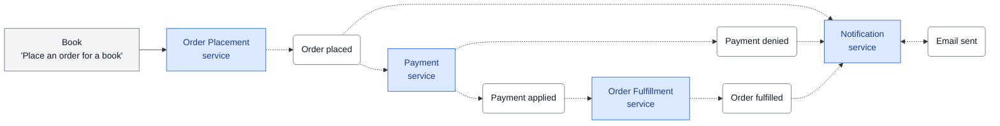
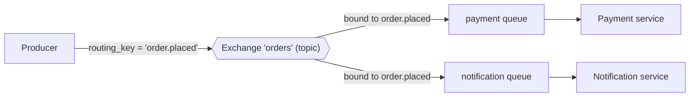

# Event-Driven Architecture

## Descripción General
- Simular el flujo señalado en verde del caso visto en clase.
- **Nota:** No es necesario implementar cobros ni enviar notificaciones; es suficiente con generar los eventos correspondientes.

---

## Servicios, Broker y Eventos

### Requisitos Técnicos
- **Aislamiento por contenedores:** Cada servicio y el broker deben ejecutarse en un contenedor separado.
- **Dockerización:**
  - Usar una imagen de Docker (`Dockerfile`).
  - Orquestar los servicios mediante Docker Compose (`docker-compose.yml` o `docker-compose.yaml`).
- **Message Broker:**
  - Opciones permitidas:
    - **RabbitMQ** (usando `pika` para Python) — *Recomendado si hay limitaciones de rendimiento o memoria en Docker.*
    - **Kafka** (usando `kafka-python`).
  - Utilizar imágenes oficiales de Docker para el broker elegido.

---

## Estructura de los Eventos
Los eventos deberán tener una estructura lógica en base a datos (ej. formato JSON):

- `event_id`: Identificador único del evento.
- `event_type`: Tipo de evento emitido.
- `timestamp`: Marca de tiempo de emisión.
- `producer`: Nombre del servicio que genera el evento.
- `payload`: Datos asociados al evento (datos de la orden).

---

## Evidencia y Trazabilidad del Flujo
- Generar evidencia dinámica sobre la ejecución del flujo (archivo de log, CSV, impresión en consola, etc.).
- El log se debe construir de manera dinámica al ejecutar la solución.
- Cada línea de registro debe incluir, por lo menos:
  ```text
  <service name> - <action (produced, consumed)> - <event_type>
  ```

---

## Ejecución del Flujo
El evento inicial (*initiating event*) deberá dispararse al correr el comando en consola:
```bash
docker compose run --rm app python place_order.py
```

---

## Entregables
- [ ] Código fuente y configuración de servicios.
- [ ] `Dockerfile` y `docker-compose.yaml`.
- [ ] `README.md` con instrucciones claras de configuración y ejecución.

## Order event flow



**Legend:** blue boxes are services, white rounded boxes are events, dotted arrows are event flow, and the solid arrow is the initial request.



